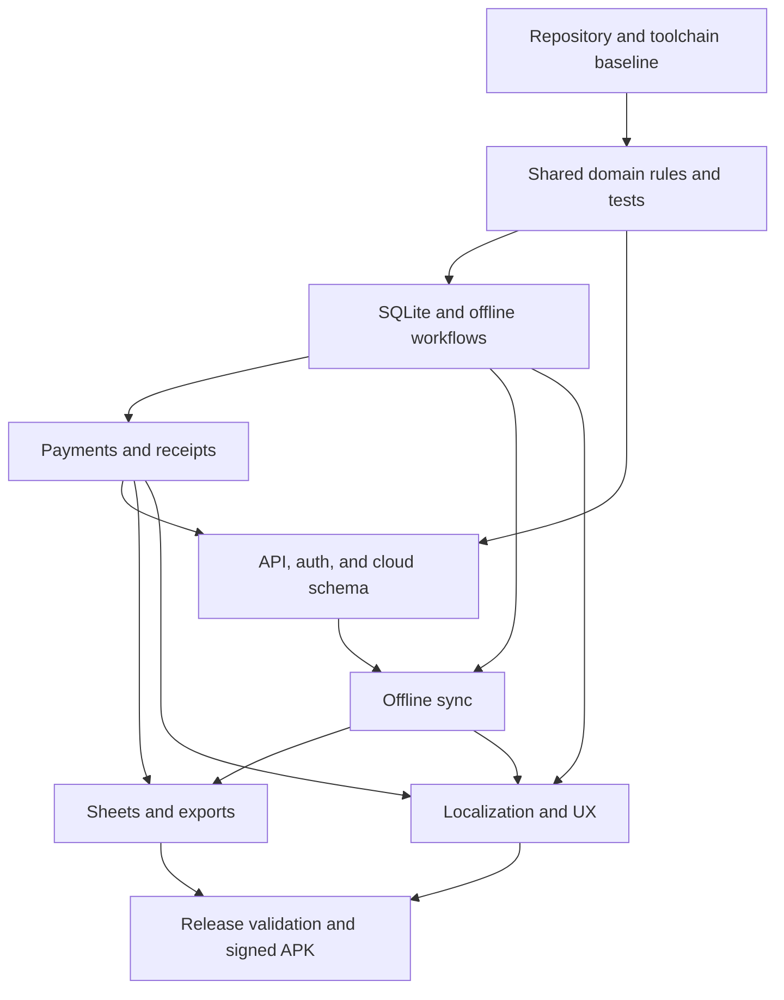

# Mobile Repair Shop Manager — Implementation Plan

## Goal

Deliver a production-ready Android app for one mobile repair shop owner. It must keep customers, repair jobs, and payment history usable offline; synchronize safely to a cloud backend; support English and Urdu; export reports; and produce a signed APK. Implement in the existing workspace after establishing its baseline.

## Inspection findings and assumptions

- The supplied workspace has no visible application source files and is not a Git repository. Phase 0 must verify this and initialize a maintainable project foundation rather than assume an existing app.
- The master prompt specifies React Native, Expo Router, TypeScript strict mode, Expo SQLite and SecureStore, Express, PostgreSQL on Neon, Prisma, and a shared validation package. Treat that as the required baseline unless compatibility checks expose a concrete blocker.
- This product is an **Android APK**, not a website. Use native React Native/Expo components. Web-only component libraries such as shadcn/ui are not suitable for native screens; do not add a separate web app unless the owner asks for one.
- The separate UI/UX specification refines the older master prompt's dark glass direction: use light mode by default, support dark mode, and favor a restrained, readable business interface over glass effects.
- Currency is PKR stored in integer minor units. Timestamps are stored in UTC; date-only fields such as expected delivery remain date-only.
- Cloud sync and Google Sheets are secondary to durable local records. A successful local save must never be reported as a successful cloud sync.

## Architecture and quality constraints

- `apps/mobile`: Expo Android app, local SQLite repositories/migrations, Expo Router, English/Urdu localization, accessible theme and UI.
- `apps/api`: strict TypeScript Express API, Prisma/PostgreSQL, secure owner authentication, validation, authorization, and centralized error handling.
- `packages/shared`: shared domain types, Zod schemas, money rules, status transitions, and constants.
- `docs`: architecture, setup, API, testing, backup/restore, and release instructions.
- Use React functional components/hooks, resilient async loading/error states, and optimistic UI only after local persistence succeeds. Avoid Tailwind utilities in native UI unless the chosen library is verified to support React Native.
- Keep secrets out of SQLite, logs, source control, and Expo public configuration. Preserve financial records through reversals/audit trails; do not silently delete payments.

## Delivery sequence

### Phase 0 — Repository baseline and foundation

- Confirm workspace contents, constraints, and available toolchain; record findings and assumptions.
- Initialize the npm workspace and the mobile, API, shared, and docs structure.
- Configure strict TypeScript, workspace scripts, lint/format conventions, environment examples, and baseline documentation.
- Verify compatible stable Expo SDK/package versions before installing dependencies.

**Exit evidence:** root scripts and package boundaries are clear; configuration has no real secrets; baseline type/lint commands are documented and usable.

### Phase 1 — Domain rules and tests

- Define customer, repair, payment, status history, sync metadata, and money schemas/types in the shared package.
- Specify permitted repair status transitions, unknown/final cost behavior, cancellation/refund policy, and payment reversal semantics.
- Implement integer-paisa totals and balance calculations, overpayment prevention, receipt ID/number uniqueness rules, and validation.
- Write unit tests for validation, calculations, reversals, transitions, dates, and idempotency before feature implementation.

**Exit evidence:** tested domain rules establish the financial and status invariants used by both app and API.

### Phase 2 — Offline persistence and customer/repair workflows

- Implement versioned SQLite schema and repositories for customers, repairs, status history, settings, and outbox operations.
- Implement initial setup, local owner session behavior after first successful login, customer CRUD/search/archive, repair registration/editing/search/filtering, receipt numbers, and repair details.
- Build database-backed dashboard figures, actionable repair lists, empty/error/loading states, and persistence across restarts.
- Preserve repair history when archiving a customer; make local search available without connectivity.

**Exit evidence:** customer and repair workflows save and reload from SQLite, including offline, with no hardcoded dashboard data.

### Phase 3 — Payments, balances, and receipts

- Store each payment as an immutable financial event with idempotency key, method, timestamp, and optional reference/note.
- Implement balance calculations from valid payment history, partial/advance payments, overpayment protection, void/reversal audit trail, and explicit cancelled-job/refund rules.
- Add payment history, payment receipt, repair receipt, and clear ready-for-delivery versus unpaid states.
- Persist each issued invoice/sale record locally with a stable unique invoice/receipt code and a snapshot of the billed customer, repair, amounts, date, and payment state, so later edits do not rewrite historical sales records.
- Ensure payment recording is transactional on the backend and concurrency-safe.

**Exit evidence:** payment examples and edge cases reconcile; delivery status never changes payment state.

### Phase 4 — API, authentication, and cloud schema

- Implement Express API, Prisma schema/migrations, Neon configuration, startup environment validation, and safe centralized error handling.
- Add owner setup/login, password hashing, short-lived access tokens, refresh rotation/revocation, auth rate limits, authorization, security headers, restricted CORS, and audit events.
- Add validated customer, repair, payment, and sync endpoints with backend enforcement of all domain rules.

**Exit evidence:** migrations and API integration tests pass against a dedicated test database; auth and sensitive-data handling meet documented security rules.

### Phase 5 — Offline synchronization and recovery

- Implement a durable SQLite outbox, retry/backoff, connectivity-aware background/manual sync, push/pull cursors, idempotency, tombstones, and conflict handling.
- Define deterministic conflict policy for edits made on multiple devices; surface unresolved conflicts instead of silently overwriting data.
- Display truthful states for synced, offline, syncing, pending count, and failure/retry. Keep all local workflows available when cloud operations fail.
- Verify recovery to a clean device from cloud records and preservation of local operations through server outages.

**Exit evidence:** retries do not duplicate customers, repairs, or payments; acknowledged operations alone leave the outbox.

### Phase 6 — Sheets integration and exports

- Implement optional server-authorized Google Sheets connection, secure token storage, stable UUID row matching, retry/deduplication, and partial-failure handling.
- Keep every customer, repair, payment, and issued invoice/sale record in the app's local SQLite database first. Excel is a downloadable export of persisted records, never the only copy or the primary data store.
- Add an individual invoice/sale `.xlsx` download and a monthly sales workbook generated from local records. Include invoice/receipt code, date, customer/repair reference, description, gross amount, payments received, outstanding balance, and totals. Include in-app invoice and monthly sales history so the owner can review records without opening Excel.
- Add other XLSX exports for customers, repairs, payments, balances, date-filtered repairs, and daily/monthly payment summaries; add CSV only if useful.
- Use accurate numeric money cells, clear dates, timestamped filenames, safe Android sharing, and honest export/sync status.

**Exit evidence:** export totals match database queries; integration failure does not block repair-shop operations.

### Phase 7 — Localization, UX, and accessibility

- Complete English and Urdu locale files and persisted language selection; implement and verify RTL navigation, forms, search, status, money, dates, and receipts.
- Implement the UI spec: light default, system/light/dark theme, teal accent, readable financial hierarchy, compact repair rows, one-hand forms, clear primary actions, and meaningful empty/error/offline states.
- Add reusable accessible components and ensure focus/labels, touch targets, text scaling, keyboard handling, and status text work across small Android screens.

**Exit evidence:** no hardcoded visible strings in screens; English LTR and Urdu RTL flows remain legible and operable.

### Phase 8 — Release readiness and signed APK

- Run required unit, API integration, migration, and applicable device/E2E scenarios; fix blocking failures and report unavailable environments honestly.
- Configure Android package ID, Expo/EAS build profiles, permissions review, and secure release signing.
- Document backend/Neon/Google setup, backup/restore, APK build/install/verification, versioning, and signing identity continuity.
- Generate and inspect the signed APK when credentials and build environment are available; never commit signing secrets.

**Exit evidence:** reproducible release instructions and verified APK artifact, or a precise list of external prerequisites preventing artifact generation.

## Key acceptance scenarios

1. Offline: create customer, repair, and partial payment; restart app; records and balances remain correct.
2. Payment integrity: Rs. 5,000 repair with Rs. 1,500 + Rs. 500 payments shows Rs. 3,000 pending; final Rs. 3,000 clears it; all three entries remain.
3. Sync recovery: outage does not lose edits; recovery retries without duplicate rows/payments; outbox clears only on server acknowledgment.
4. Concurrency/idempotency: replayed or simultaneous payment requests cannot overpay or double-record.
5. Delivery: confirm delivery records actual date while unpaid status remains visible and unchanged.
6. Localization: switching to Urdu gives usable RTL navigation, forms, validation, financial summaries, and receipts.
7. Restore/export: cloud recovery preserves relationships; XLSX report totals reconcile with local records.

## Risks and decisions to resolve during implementation

- No repository baseline exists yet; package manager, Node/Expo versions, and Android build tooling must be checked in Phase 0.
- Expo SDK and native SQLite, background task, localization, and build plugins must be checked for current compatibility before dependency selection.
- Automatic sync scheduling is constrained by Android background execution; design for reliable foreground/connectivity-triggered sync plus platform-supported background work.
- Google OAuth, Neon deployment, EAS signing, and real-device Urdu validation require external credentials/services/devices and may be documented or simulated in isolated tests when unavailable.
- Conflict resolution and cancelled repair/refund behavior must be explicit before sync and payment implementation.

## Security and integration review — required plan corrections

These items close gaps in the initial plan and are implementation gates, not optional polish.

### Authentication and owner access

- **Define owner provisioning before building setup/login.** This is a single-owner product, so an unrestricted public `setup`/registration endpoint could let another person claim the shop. Use a one-time bootstrap flow that is unavailable after an owner exists (for example, a high-entropy, short-lived setup code configured out-of-band), then disable it. Make bootstrap atomic in the database so two concurrent requests cannot create competing owners. Do not ship a default password or setup secret.
- **Specify password recovery and account lockout behavior.** The prompt has login/logout but no recovery procedure. Document a verified owner recovery channel and rate-limited reset flow, plus an offline message explaining that credential recovery needs connectivity. Do not reveal whether an email/account exists in login or reset responses. Use generic authentication failures and throttling that account for both IP and account identifier; avoid permanent lockout that an attacker can trigger.
- **Specify the token lifecycle.** Keep short-lived access tokens in memory where practical; store only the refresh credential in SecureStore. Rotate refresh tokens on use, persist only a one-way hash/fingerprint server-side, detect refresh-token reuse, revoke the token family, and support revoking all sessions after password reset or suspected compromise. Define session expiry, logout behavior, clock-skew tolerance, and what happens when refresh fails while the device is offline.
- **Separate authenticated cloud access from local offline access.** After at least one successful login, permit access to already-synced local records offline under a documented local-unlock policy. Never accept an offline login as proof of fresh cloud identity or queue privileged account changes. On logout, lock the app and state whether local records are retained, encrypted, or wiped; clarify how the owner can regain them. Server-side revocation cannot remotely erase a phone that is offline.
- **Authorize every object by the owning account/shop.** Derive owner identity from the validated session, never from a caller-supplied `ownerId`/`shopId`. Enforce ownership for all reads, writes, exports, sync cursors, and Google integration endpoints, including UUID-based routes. Add cross-owner IDOR tests even though v1 is single-owner.

### Device storage and privacy

- **Threat-model the local SQLite database.** It contains names, phone numbers, addresses, notes, IMEIs, payment history, and refresh/outbox metadata. SecureStore protects small credentials, not SQLite rows. Choose and document SQLCipher/another supported database encryption approach with a key protected by Android Keystore, or explicitly document the at-rest limitation and require device screen lock/app re-authentication for sensitive actions. Verify that the selected encryption package works with the chosen Expo SDK, EAS native build, migrations, and backup/restore before committing to it.
- **Define Android backup behavior.** Exclude SecureStore entries from OS backup and test restore behavior; Expo documents that Android Keystore keys are removed on uninstall and restored SecureStore values cannot then be decrypted. Decide separately whether the SQLite DB is excluded from Auto Backup or backed up only via a deliberate encrypted app export. Do not treat cloud device backup as the app's verified backup/restore feature. See [Expo SecureStore data persistence and Android Auto Backup](https://docs.expo.dev/versions/latest/sdk/securestore/) and [Android Auto Backup](https://developer.android.com/identity/data/autobackup).
- Keep IMEI, tokens, payment references, customer notes, request bodies, and auth headers out of logs, analytics, crash reports, and sync error text. Minimize IMEI collection and provide a clear reason it is needed. Review screenshots/app-switcher previews, clipboard/share behavior, and exported files for accidental disclosure.
- Treat backup, restore, and exports as sensitive-data operations: require an explicit destination/share action, show the included data, use timestamped filenames, and never silently overwrite. If CSV export is added, neutralize spreadsheet formula cells; for XLSX, write untrusted strings as text cells. Do not include credentials or integration tokens in exports.
- Add transport and deployment rules: HTTPS only in production, no permissive cleartext exception, strict server-side input validation, request/body limits, secret rotation, dependency/security update process, and production error responses without stack traces or database details. CORS is a browser control, not authorization; retain it if needed but do not count it as protection for the native Android client.

### Google, API, database, and sync integration risks

- **Use a supported mobile OAuth path.** The master prompt's “server-side authorization flow” needs a concrete mobile handoff: system browser, exact redirect URI, one-time `state`, PKCE where applicable, least-privilege Sheets scopes, and tokens stored encrypted on the backend. Do not use an embedded webview or a desktop loopback redirect for Android; Google's native-app guidance deprecates loopback redirects for Android/iOS. See [Google OAuth for native apps](https://developers.google.com/identity/protocols/oauth2/native-app) and its [loopback migration guide](https://developers.google.com/identity/protocols/oauth2/resources/loopback-migration). Test cancel, expired consent, revoked access, token refresh, and disconnect. Keep Sheets failures isolated from core sync and show the last successful Sheets sync separately from backend sync.
- **Make sync ordering and ownership explicit.** Use stable client-generated UUIDs, unique constraints, per-owner idempotency keys, foreign-key dependency ordering (customer before repair, repair before payment), cursor-based pulls, tombstones, schema/version compatibility, and bounded retry with jitter. Persist outbox operations transactionally with local mutations. Define server acknowledgment semantics and conflict resolution for concurrent edits; do not resolve financial conflicts with last-write-wins. Ensure retries after partial batch success cannot duplicate payment or status events.
- **Handle auth refresh during sync safely.** Serialize refresh per device/session so concurrent requests do not rotate the same refresh token and invalidate one another. On `401`, refresh once and retry an idempotent operation; on revoked/expired credentials stop cloud retries, retain the outbox, mark re-authentication required, and continue allowed local work. Never put credentials into queued payloads.
- **Protect financial concurrency at the database.** A read-then-insert payment check can race. Use a transaction with row locking or another proven serialization/conditional-update strategy and a unique idempotency constraint; test concurrent requests against PostgreSQL. Define how cost edits interact with payments already accepted, reversals/refunds, and in-flight offline payments before finalizing the conflict policy.
- **Check Neon/Prisma runtime details.** Separate pooled runtime connection configuration from direct migration connection configuration when required by the selected Neon/Prisma versions. Run migrations as a controlled deployment step, not on every API instance startup. Exercise connection loss, transaction limits, pool exhaustion, and API restart behavior in integration/staging environments.
- **Make dates and identifiers interoperable.** Use UTC timestamps for instants, date-only types for expected delivery, and one documented shop timezone for “today,” overdue jobs, and daily reports. Generate receipt numbers under a database uniqueness rule that remains collision-safe across offline devices; define how provisional offline receipt numbers are reconciled without changing a receipt already issued to a customer.
- **Document data lifecycle and recovery.** Define retention, owner account deletion/export, device loss/revocation, backup encryption, restore merge/replace semantics, duplicate handling, and recovery when SecureStore credentials are lost after reinstall. Test a clean-device restore and a revoked-device sync attempt.

### Additional security and integration acceptance tests

1. Concurrent first-run bootstrap creates at most one owner; setup cannot be reused or claimed by a second party.
2. Login/reset responses resist account enumeration; throttling blocks brute-force attempts without allowing trivial denial of service against the owner.
3. Expired, rotated, replayed, revoked, and malformed access/refresh credentials are rejected; refresh races and logout/revocation are covered.
4. Every API endpoint rejects a valid user/session attempting to read or mutate another owner's UUIDs, sync cursor, exports, or integration settings.
5. Offline local access follows the documented first-login and logout policy; expired cloud credentials do not delete local data or discard queued operations.
6. Sensitive data is absent from application/API logs and crash output; Android backup excludes unrecoverable SecureStore entries and follows the documented DB policy.
7. OAuth state mismatch, cancelled consent, revoked Sheets grants, and refresh failure do not expose tokens or block repairs/payments.
8. Duplicate/replayed sync batches, dependency ordering, tombstones, schema mismatch, and conflicting financial edits behave deterministically.
9. Concurrent payments, payment replay, cost edits, reversals, and offline payment replay preserve the no-overpayment invariant.
10. Export cells cannot execute untrusted spreadsheet formulas; restore and sharing flows make the destination and data scope clear.
11. Issuing an invoice while offline creates a durable in-app invoice/sale record and an individual downloadable Excel file; the monthly workbook includes it exactly once and reconciles to in-app sales totals.

## Open decisions to settle before implementation

1. **Local data protection:** encrypted SQLite with a Keystore-protected key, or documented platform-sandbox protection with explicit residual risk and app-lock requirements?
2. **Owner recovery:** which verified recovery channel can this single-owner shop use, and how can recovery work if the device is offline or lost?
3. **Bootstrap:** how is the first owner provisioned securely without public self-registration or a committed setup secret?
4. **Logout/local data:** should logout lock local records for the next app launch, retain them behind app re-authentication, or wipe them? This affects the offline promise and device-loss exposure.
5. **Sheets connection:** should OAuth be initiated through a backend-owned browser callback, or a maintained native Google authorization SDK with a backend token exchange? Confirm supported redirect and consent model before implementation.
6. **Offline receipt numbers:** use a visibly provisional device-prefixed number until server allocation, or reserve number ranges while online? Issued customer receipts should not silently change after sync.
7. **Meaning of “Excel code”:** confirm whether each workbook needs a stable invoice/receipt code column, spreadsheet formulas for totals, or both. Until clarified, include a unique invoice/receipt code and numeric totals, with totals calculated and verified by the app.

## Dependency flow

## Implementation gate

This plan is for review. Begin implementation after the plan is approved in the canvas. Update the plan if review feedback changes scope or ordering.
